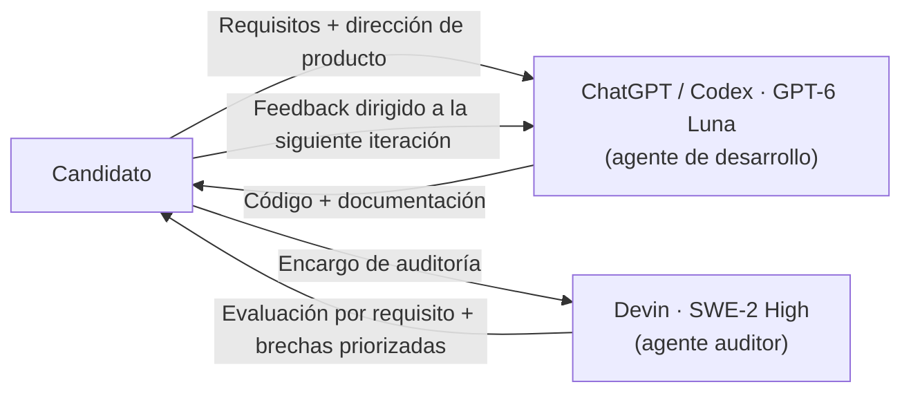

# Bitácora de uso de inteligencia artificial

## Flujo de trabajo multi-agente

El proyecto se desarrolló orquestando **dos agentes de IA con roles distintos y herramientas diferentes**:

| Rol | Herramienta | Modelo | Responsabilidad |
| --- | --- | --- | --- |
| Desarrollo | ChatGPT con Codex | GPT-6 Luna — esfuerzo de razonamiento `high` | Implementación del frontend, la API REST, la sincronización en tiempo real y la documentación base |
| Auditoría | Devin (Devin Desktop / Windsurf) | SWE-2 High | Auditoría del código, evaluación requisito por requisito contra el enunciado y feedback para iterar |

La documentación oficial de OpenAI enumera `high` entre los niveles de razonamiento compatibles con GPT-6 Luna: [GPT-6 Luna — OpenAI API](https://developers.openai.com/api/docs/models/gpt-6-luna).



Este esquema reproduce un patrón de trabajo agéntico deliberado: un agente construye y otro —con contexto y herramientas independientes— verifica. Separar los roles evita que el mismo agente "califique su propia tarea" y le da al candidato una segunda lectura objetiva del entregable antes de cada iteración.

## Índice de prompts

| # | Herramienta | Fidelidad | Propósito |
| --- | --- | --- | --- |
| 1 | ChatGPT / Codex | Reconstruido | Generar la base completa: SPA, API, tiempo real y documentación |
| 2 | ChatGPT / Codex | Consolidado | Refinamiento de la dirección visual |
| 3 | ChatGPT / Codex | Consolidado | Incluir sincronización en tiempo real con Socket.IO |
| 4 | Devin / SWE-2 High | Reconstruido | Auditoría independiente del entregable y evaluación del nivel |

**Convención de fidelidad:**

- **Literal:** copia exacta del mensaje enviado al agente.
- **Reconstruido:** redacción editorial posterior que reúne los requisitos y decisiones reales de la colaboración para hacer el proceso reproducible; no es una transcripción de un único mensaje histórico.
- **Consolidado:** formaliza feedback dado de forma iterativa a lo largo de varios mensajes.

## Alcance del apoyo por herramienta

### ChatGPT / Codex — desarrollo

La IA convirtió los requisitos de la prueba en una primera versión funcional y documentada. Las tareas asistidas incluyeron:

- proponer y preparar la estructura del monorepo para frontend y backend;
- elaborar el dashboard, el formulario lateral de VM, los estados de carga y las notificaciones;
- implementar el login con cookie HttpOnly, autorización por rol, endpoints CRUD y persistencia SQLite;
- conectar eventos Socket.IO para sincronizar cambios entre sesiones;
- preparar cuentas de demostración, el README, la guía técnica y el manual de uso.

### Devin / SWE-2 High — auditoría

El segundo agente recibió el enunciado y el código ya implementado, con la consigna de auditar sin modificar. Su trabajo incluyó:

- leer el enunciado completo y derivar la lista exhaustiva de requisitos evaluables;
- auditar frontend y backend requisito por requisito, clasificando cada uno como cumplido, parcial o ausente;
- verificar la compilación real de ambas aplicaciones (`tsc` de la API y `tsc` + `vite build` del frontend, ambos exitosos);
- contrastar lo que la documentación declara contra lo que el código efectivamente hace;
- devolver una evaluación con brechas priorizadas y un veredicto sobre el nivel del entregable.

Hallazgos reportados por la auditoría, aceptados como trabajo pendiente de iteración:

- el enunciado pide rutas públicas y privadas y la implementación usa render condicional sin router;
- el frontend concentra todo el estado y los componentes en un único `App.tsx`, sin una solución dedicada de estado global;
- los cambios recibidos por Socket.IO actualizan el estado, pero sin la animación de resaltado que pide el enunciado;
- la validación del formulario ocurre al enviar, no en tiempo real;
- el repositorio git fue inicializado pero aún sin commits ni publicación.

## Decisiones e intervención del candidato

La IA propuso y redactó una base inicial; las decisiones de producto y los criterios de aceptación se definieron durante la colaboración. El candidato especificó y ajustó:

- React, TypeScript y Vite para el frontend; Node.js, Express y TypeScript para la API; SQLite para persistencia.
- La inclusión de WebSockets desde el inicio.
- Una estética minimalista, elegante y sobria, con transiciones cuidadas, drawers y sin glassmorphism.
- La necesidad de documentar las cuentas de prueba en un manual funcional y en documentación técnica.
- La corrección de omisiones detectadas durante la revisión, incluida la preparación de Git y de convenciones del repositorio.
- La orquestación de un segundo agente independiente como auditor, con instrucciones explícitas de verificación objetiva, y el uso de su reporte como insumo para dirigir la siguiente iteración del agente de desarrollo.

La compilación de frontend y backend se ejecutó como verificación técnica. Antes de publicar, el candidato debe revisar el código, recorrer los flujos principales y confirmar que las decisiones implementadas corresponden a los requisitos de la prueba.

## Prompt 1 — Desarrollo inicial · ChatGPT/Codex · reconstruido

> **Nota de fidelidad:** este prompt es una reconstrucción editorial que reúne los requisitos de la prueba y las decisiones definidas durante la colaboración. Está redactado para que el proceso sea reproducible; no es una transcripción literal de un único mensaje histórico.

```text
Actúa como arquitecto de software y desarrollador full stack senior. Ayúdame a diseñar e implementar una SPA profesional para administrar máquinas virtuales, tomando como base los requisitos de una prueba técnica Full Stack con énfasis en frontend. El resultado debe ser claro, mantenible, responsivo y fácil de ejecutar localmente.

CONTEXTO Y STACK
- Usa React, TypeScript y Vite para el frontend.
- Usa Node.js, Express y TypeScript para la API REST.
- Usa SQLite para persistencia local y Socket.IO para la sincronización en tiempo real.
- Mantén frontend y backend separados por aplicación dentro de un monorepo npm.
- Separa componentes, acceso a datos y responsabilidades de API con una estructura legible; evita tanto los archivos monolíticos como la abstracción innecesaria.

DIRECCIÓN VISUAL
- Diseña una consola minimalista, elegante y profesional, con una percepción sobria y de alta calidad.
- Prioriza jerarquía tipográfica, espaciado, alineación, contraste y lectura rápida de datos.
- Usa colores discretos y un acento refinado. Incluye tema oscuro y claro.
- Emplea drawers para crear y editar VMs, y transiciones breves y elegantes que expliquen los cambios de estado.
- Haz que la interfaz sea intuitiva, adaptable a móvil y accesible mediante teclado.

REGLAS VISUALES QUE NO SE DEBEN ROMPER
- No uses glassmorphism.
- No recargues la interfaz con efectos, gradientes intensos, brillos, sombras decorativas o animaciones innecesarias.
- No sacrifiques legibilidad ni consistencia por adornos.
- No presentes métricas de monitoreo ficticias como si fueran datos reales; calcula los indicadores a partir de las VMs disponibles o identifícalos claramente como demostración.

FUNCIONALIDAD DEL FRONTEND
- Implementa una ruta pública de login y vistas privadas para dashboard e inventario.
- Diferencia los roles Administrador y Cliente. El Cliente debe tener una vista de solo lectura: oculta por completo las acciones de crear, editar y eliminar.
- El Administrador puede crear, consultar, editar y eliminar VMs con nombre, cores, RAM, disco, sistema operativo y estado.
- Valida los campos en tiempo real y vuelve a validarlos en el servidor.
- Implementa actualización optimista en altas, cambios y eliminaciones; si la API falla, revierte el estado y comunica el error.
- Muestra sumas de cores, RAM y disco de las VMs activas mediante visualizaciones claras.
- Incluye skeletons, estados vacíos, errores visibles y notificaciones toast.
- Incluye desde el inicio Socket.IO autenticado: propaga la creación, actualización y eliminación de VMs a las demás sesiones y resalta los cambios con discreción.

REGLAS DE SEGURIDAD QUE NO SE DEBEN ROMPER
- No devuelvas el JWT en el body ni lo guardes en localStorage o sessionStorage.
- Mantén el JWT en una cookie HttpOnly, SameSite y Secure en producción; permite la cookie no Secure únicamente en desarrollo local HTTP.
- Envía credenciales de cookie con las peticiones y autentica también la conexión de Socket.IO.
- Protege cada ruta en el backend. No confíes solo en ocultar controles en el frontend: únicamente el Administrador puede crear, editar o borrar.
- Almacena contraseñas con hash. No subas secretos, credenciales reales, bases de datos locales ni archivos generados al repositorio.
- Valida entradas y devuelve errores comprensibles sin filtrar información sensible.

ENTREGABLES Y FORMA DE TRABAJO
- Prepara un README con pasos para instalar y ejecutar localmente, variables de entorno y cuentas de prueba.
- Documenta arquitectura, decisiones técnicas y eventos de tiempo real.
- Prepara un manual de uso que explique los flujos para Administrador y Cliente.
- Incluye una Bitácora de IA transparente, que diferencie los prompts literales de los reconstruidos y describa las decisiones humanas.
- Trabaja por etapas: explica brevemente la arquitectura, implementa la funcionalidad, compila el proyecto y comunica qué quedó hecho, qué verificaste y qué limitaciones permanecen.
- No declares terminado un requisito que no esté implementado y verificado.
```

## Prompt 2 — Refinamiento visual · ChatGPT/Codex · consolidado

> Toma como dirección una interfaz minimalista y de alto nivel: sobria, elegante, profesional e intuitiva. Evita glassmorphism. Usa transiciones elegantes, drawers para la creación y edición, colores discretos y una jerarquía visual clara. Cada elemento destacado debe ayudar a entender una acción, un estado o una métrica; evita adornos sin función.

Este texto consolida el feedback de diseño dado durante la colaboración.

## Prompt 3 — Tiempo real con Socket.IO · ChatGPT/Codex · consolidado

> Implementa la sincronización en tiempo real desde el inicio con Socket.IO. Autentica la conexión con la sesión del usuario y emite eventos de creación, actualización y eliminación de VMs para que las sesiones conectadas mantengan el inventario actualizado. Conserva los permisos por rol en la API y acompaña el cambio remoto con una animación breve y discreta.

Este texto formaliza la decisión de incluir WebSockets desde el inicio y la integra con los requisitos de seguridad de la prueba.

## Prompt 4 — Auditoría independiente · Devin/SWE-2 High · reconstruido

> **Nota de fidelidad:** reconstrucción editorial del encargo de auditoría realizado sobre el entregable. El agente auditor trabajó en una sesión separada, con herramientas propias de lectura, búsqueda y ejecución, y sin modificar el código.

```text
Actúa como auditor técnico independiente dentro de un flujo de trabajo multi-agente.

CONTEXTO
- Otro agente (ChatGPT/Codex, GPT-6 Luna) implementó una prueba técnica Full Stack con énfasis en frontend: una SPA de gestión de máquinas virtuales con API REST, autenticación por cookie HttpOnly, control por roles y sincronización en tiempo real.
- El enunciado de la prueba está en el workspace, junto con el código del monorepo.
- Tu rol no es implementar ni corregir: es auditar, evaluar y devolver feedback accionable que yo usaré para dirigir la siguiente iteración del agente de desarrollo. No compartes contexto con el agente constructor; esa independencia es intencional.

TU MISIÓN
1. Lee el enunciado completo y extrae la lista exhaustiva de requisitos: funcionales, de seguridad, de UX y de entregables/documentación.
2. Audita el código de ambas aplicaciones contra cada requisito. Clasifica cada uno como cumplido, parcial o ausente, citando el archivo correspondiente.
3. Verifica, no asumas: si un requisito parece cumplido, confírmalo en el código antes de marcarlo. Ejecuta la compilación del frontend y del backend como evidencia.
4. Contrasta la documentación con el comportamiento real: señala cualquier afirmación del README o de la documentación técnica que el código no respalde.
5. Evalúa la calidad arquitectónica: separación de componentes, manejo de estado global, modelo de rutas, seguridad real del backend y resiliencia del flujo de datos.
6. Devuélveme tres artefactos:
   a) una evaluación requisito por requisito;
   b) una lista de brechas priorizada por impacto en la rúbrica de evaluación;
   c) tu veredicto honesto sobre si el nivel del entregable corresponde a un perfil senior, con los argumentos que lo sostienen.

REGLAS
- Solo lee, busca y ejecuta verificaciones; no edites el código auditado.
- Sé objetivo aunque el hallazgo sea incómodo: un defecto encontrado ahora vale más que una aprobación optimista.
- Distingue siempre entre "implementado y verificado", "implementado a medias" y "no implementado"; no mezcles categorías.
- Termina indicándome exactamente qué debe cambiar antes de la entrega final.
```

## Resultado y revisión

La colaboración produjo una base local del dashboard, API, seed de demostración y documentación. El build de producción de TypeScript/Vite para frontend y backend terminó correctamente, verificado tanto por el agente de desarrollo como por el auditor.

La evaluación del candidato confirmó el cumplimiento de los ejes centrales y señaló brechas concretas en rutas, organización del frontend, validación mientras se escribe y feedback visual de Socket.IO. En respuesta se incorporaron React Router con rutas protegidas, Zustand para el estado compartido, componentes separados por funcionalidad, validación al salir y corregir campos, y resaltado temporal de filas modificadas. El build de producción volvió a completarse correctamente después de los cambios.

## Intervenciones concretas durante la revisión

La participación humana incluyó decisiones y correcciones de alcance, no solo una revisión general:

1. **Selección de tecnologías y experiencia:** el candidato confirmó React y TypeScript, SQLite y la inclusión de WebSockets desde el inicio. Definió el criterio visual minimalista, elegante y sobrio, pidió evitar glassmorphism y priorizó drawers y transiciones cuidadas.
2. **Trazabilidad del trabajo:** el candidato observó que no había commits visibles y solicitó un flujo Git profesional. Se inicializó el repositorio local en `main` y se añadieron convenciones de archivos y contribución. Para crear commits con autoría correcta falta configurar el correo del candidato; también queda pendiente crear y conectar el remoto de GitHub.
3. **Revisión crítica del frontend:** el candidato presentó una evaluación que detectó rutas simuladas, estado concentrado en `App.tsx`, validación solo al enviar y ausencia de resaltado al recibir `vm:updated`. A partir de esas observaciones se incorporaron rutas de React Router con guards, Zustand para el estado compartido, componentes separados por funcionalidad, validación al salir y corregir campos, y un resaltado breve de las filas actualizadas por Socket.IO.
4. **Revisión de entregables:** el candidato pidió una bitácora de IA con un prompt inicial profesional y la identificación del modelo GPT-6 Luna con esfuerzo High. El prompt inicial de este documento se marca como reconstrucción editorial y no como transcripción literal.

El repositorio sigue siendo local: la bitácora no afirma que exista una URL de GitHub. La revisión funcional y de seguridad debe continuar antes de publicar; esta bitácora no la sustituye.
