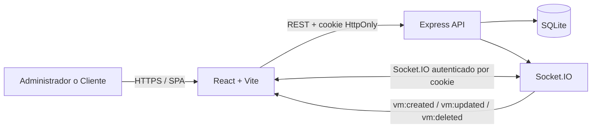

# Documentación técnica

## Arquitectura

El repositorio es un monorepo npm con dos aplicaciones independientes:

- `apps/web`: SPA en React, TypeScript y Vite.
- `apps/api`: API REST en Express, TypeScript y SQLite, con Socket.IO en el mismo servidor HTTP.



En desarrollo, Vite publica el frontend en `localhost:5173` y redirige `/api` y `/socket.io` a Express en `localhost:4000`. En producción, configurar el origen del frontend en `WEB_ORIGIN` y servir ambos dominios bajo HTTPS, con CORS de credenciales habilitado.

## Tecnologías y decisiones

- **React + TypeScript + Vite:** SPA con componentes tipados y ciclo rápido de desarrollo.
- **React Router:** rutas reales para acceso público, dashboard, inventario, creación y edición; `ProtectedRoute` y `AdminRoute` controlan el acceso en cliente, junto con las autorizaciones de la API.
- **Zustand:** estado compartido de sesión, inventario, carga, conexión y resaltados de eventos; concentra el estado del servidor que consumen las vistas.
- **Express:** endpoints HTTP y middleware de autenticación/autorización.
- **SQLite + sql.js:** persistencia local en un archivo SQLite, sin requerir compilar módulos nativos durante la instalación.
- **JWT + cookie HttpOnly:** el frontend no puede leer el token; las peticiones usan `credentials: 'include'`.
- **Socket.IO:** emite los cambios de VM a todas las sesiones que acreditan una cookie válida.
- **Validación con Zod:** validación del payload en el backend, complementada con validación inmediata en el formulario.
- **CSS propio:** estilos explícitos para conservar una estética minimalista y sobria, sin dependencias de componentes ni glassmorphism.

## Flujo de autenticación y autorización

1. `POST /api/login` valida credenciales y firma el JWT con vencimiento de ocho horas.
2. El servidor devuelve el usuario y rol, y escribe el token en la cookie `ifx_session` (`HttpOnly`, `SameSite=Lax`; `Secure` se activa con `COOKIE_SECURE=true`).
3. `GET /api/me` valida la sesión para restaurar la interfaz después de recargar.
4. `requireAuth` protege los endpoints de VM; `requireAdmin` limita escritura y borrado a Administrador.
5. El middleware de Socket.IO verifica la cookie y el JWT antes de aceptar una conexión.
6. Cerrar sesión invalida la cookie del navegador. El JWT deja de ser utilizable al expirar.

En frontend, `/login` es pública; `/dashboard` y `/vms` requieren sesión. `/vms/new` y `/vms/:id/edit` requieren rol Administrador. Las rutas de administración redirigen a Cliente al inventario de solo lectura. La autorización real siempre se vuelve a aplicar en el servidor.

En desarrollo se usa `COOKIE_SECURE=false` porque el origen local es HTTP. En producción debe activarse HTTPS y `COOKIE_SECURE=true`, configurarse un secreto aleatorio y restringirse `WEB_ORIGIN` al dominio autorizado.

## Endpoints

Todos los endpoints, salvo login y health, requieren la cookie de sesión.

| Método | Ruta | Acceso | Descripción |
| --- | --- | --- | --- |
| `GET` | `/api/health` | Público | Estado de API. |
| `POST` | `/api/login` | Público | Inicia sesión y establece cookie; responde `{ user }`. |
| `POST` | `/api/logout` | Público | Limpia la cookie. |
| `GET` | `/api/me` | Autenticado | Devuelve el usuario de la sesión. |
| `GET` | `/api/vms` | Admin y Cliente | Lista todas las VMs. |
| `POST` | `/api/vms` | Solo Admin | Crea VM. |
| `PUT` | `/api/vms/:id` | Solo Admin | Actualiza VM. |
| `DELETE` | `/api/vms/:id` | Solo Admin | Elimina VM. |

Payload para crear o actualizar:

```json
{
  "name": "Production API",
  "cores": 8,
  "ram": 32,
  "disk": 480,
  "os": "Ubuntu 24.04 LTS",
  "status": "running"
}
```

`status` admite `running`, `stopped` o `paused`. RAM y disco se expresan en GB. En la pantalla, Cliente no recibe botones CRUD y la API también rechaza las mutaciones con `403`.

## Eventos Socket.IO

El servidor emite a todas las sesiones autenticadas:

- `vm:created`: contiene el registro nuevo.
- `vm:updated`: contiene el registro actualizado.
- `vm:deleted`: contiene `{ id }`.

La interfaz aplica cada evento al inventario del store global. Las actualizaciones remotas resaltan brevemente la fila afectada con una transición discreta. Antes de la respuesta HTTP, el usuario administrador ve un cambio optimista; si la API falla se restaura el dato anterior.

## Estructura

```text
vm-dashboard/
├── apps/
│   ├── api/src/        # servidor, autenticación, rutas y SQLite/seed
│   └── web/src/
│       ├── features/auth/ # acceso y sesión
│       ├── features/vms/  # fila, formulario lateral y validación
│       ├── components/    # componentes compartidos del dashboard
│       ├── store/         # estado global Zustand
│       ├── App.tsx        # rutas y composición del dashboard
│       └── api.ts         # cliente HTTP tipado
├── docs/               # manual y arquitectura
├── .env.example
└── README.md
```

## Datos y seed

Al iniciar, `apps/api/src/db.ts` crea las tablas `users` y `vms` si no existen. Si la tabla de usuarios está vacía, agrega las dos cuentas de demostración; si el inventario está vacío, inserta cinco VMs. Los hashes de contraseña se calculan con bcrypt. La ubicación se puede cambiar con `DATABASE_PATH`.

## Consideraciones antes de producción

- Reemplazar las credenciales de demostración y el secreto JWT.
- Habilitar `COOKIE_SECURE=true` exclusivamente detrás de HTTPS.
- Configurar `WEB_ORIGIN` al origen exacto de producción y revisar los dominios de cookie.
- Añadir rate limiting al login, auditoría de operaciones y gestión de sesiones/revocación según el entorno.
- Definir backups, estrategia de migraciones y almacenamiento persistente para SQLite o migrar a un servicio de base de datos si la carga crece.
